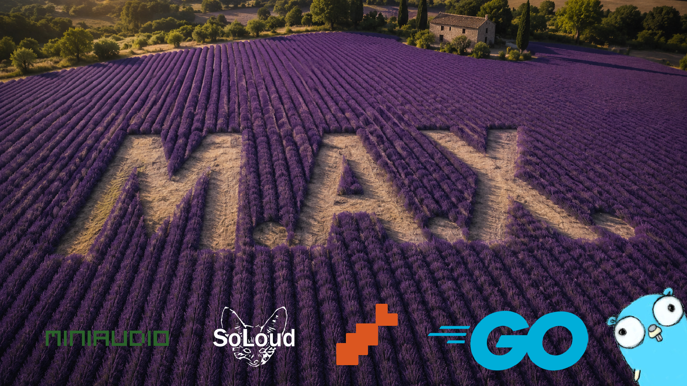

# max-go

Independent Go reimplementation of the gameplay and runtime behavior of Interplay's **M.A.X.: Mechanized Assault & Exploration**, the 1996 turn-based strategy game by Interplay Productions.




## The Project

This noncommercial preservation project targets the single-player mode of vanilla M.A.X. on modern x86-64 systems.\
New game logic is written in Go and informed by observed vanilla gameplay and an other online M.A.X. port.\
max-go implements that behavior in Go on top of [Ebitengine](https://ebitengine.org/).\
It does not depend on SDL and avoids CGO for its libraries.\
Audio can use Oto, SoLoud, or miniaudio through wrapper libraries.\
The compiled versions of SoLoud and miniaudio are shipped with the release, including their licenses.


AI tools are used during development for research, implementation, and testing.


## Original M.A.X.

M.A.X. COPYRIGHT (C) 1996 Interplay Productions. All Rights Reserved.


This project has no affiliation with Interplay or the current M.A.X. IP holder.\
It is a noncommercial hobby project focused on preserving the 1996 MS-DOS game for modern systems.


## Compatibility and additions

The project aims to preserve the vanilla single-player experience while adding modern platform support.


It also adds these quality of life (QOL) features:
- Windows and Linux support
- Mouse-wheel zoom
- Unit groups from 1..9 instead of only 1..4
- F2 recalls a special Debug menu (only when Debug is enabled in max-go.json)
- F10 cycles screen brightness settings
- F11 switches between Fullscreen/Windowed mode
- F12 takes in-game screenshots
- Additional command-line flags
- Random mode with adjustable difficulty, alien derelicts, resource richness, and NPC counts
- max-restool for working with user-supplied RES files and local modding
- max-convert for converting user-supplied game data to formats such as BMP, PNG, WAV, and TXT
- max-settings tool for editing max-go.json
- Vanilla easter eggs are preserved (Waldo and rusted C&C Harvester)
- Support for widescreen mode (16:9) and the vanilla screen mode (4:3)
- Support for rich set of sound libraries (Oto, SoLoud and standalone MiniAudio driver)


Future QOL features are on the roadmap. 


## Source repository

The project repository is:

```
https://github.com/suglasp/max-go
```


## Game data is not included

max-go provides the engine and tools, but it does not include the original game's data.\
It requires data files from a legally obtained copy of the original game (`MAX.RES`, `*.WRL`, `*.WAV`, `*.FLC`, ...).\
You can buy M.A.X. on [GOG.com](https://www.gog.com/game/m_a_x_m_a_x_2) or [Steam](https://store.steampowered.com/app/615250/MAX_Mechanized_Assault__Exploration/),\
then point `data_dir` in `max-go.json` at that installation or copy the data into a local folder next to the max-go binary.\
The executable, user-owned game data, save files, and screenshots can all live in one local folder.

If no data path is configured and `MAX.RES` is missing next to the binary, max-go can copy data from an existing media installation of GOG or Steam on the same machine, with a typed path as fallback.\
The bootstrap shows its progress on screen. It does not download game data, and releases contain no original game data or retail assets.\
A path set explicitly (`data_dir`, `MAX_DATA_DIR`, or `-datadir`) is used as given and never triggers the bootstrap.


## max-go Tooling

max-go comes with several add-on utilities:
- max-restool : extracts user-supplied `*.RES` file(s)
- max-convert : converts user-supplied game data to formats such as WAV, BMP, TXT, and CSV
- max-settings : CLI configuration tool for max-go.json


## max-go Documenting

The project documents the file formats used by M.A.X. in markdown format.


## max-go Building and running

Building requires Go 1.26+ on Windows or Linux (x86-64 only).\
Since most OS versions nowadays are 64-bit, we targeted this port to compile and run on x86-64 instruction set CPU's.

```
go build -o bin/ ./cmd/max-go
./bin/max-go
```

The convenience scripts build the game and tools, write CLI help files, and pack `LANG.RES` (project language resources from `langres/`, see `langres/HOWTO.txt`) plus copy the SoLoud and miniaudio native libraries from `dependencies/soloud-bin/` and `dependencies/miniaudio-bin/`.\
Each platform uses its own build folder (`build/windows-x64/` or `build/linux-x64/`). The stage step copies the native platform's build into `bin/`.\
Each build packs its completed platform folders into `release/` as `max-go-<version>-<platform>.zip` or `.tar.zst`:

```
build-windows.cmd
```

```
./build-linux.sh
```

```
stage-windows.cmd
run-windows.cmd
```

```
./stage-linux.sh
./run-linux.sh
```

Set `MAX_GO_BUILD_ONLY=1` before running either script to skip release archives.\
Linux cross-builds the complete Windows release. Windows cross-builds the three Linux utilities; the Linux game build requires CGO and X11 headers.\
Build dependency layout is documented in [docs/build/dependencies.md](docs/build/dependencies.md).


The `bin/` folder is ignored by git: put the compiled binary there, and optionally copy the game data next to it\
(or leave the data where it is and point `data_dir` in `max-go.json` at it).\
Game data files (`*.RES`, `*.WRL`, ...) are ignored throughout this repository to reduce the chance of an accidental commit.

On first run a `max-go.json` is created next to the binary (audio backend `ebiten`, `soloud`, or `miniaudio`,\
fullscreen/window scale, volumes, keybinds)\
A `settings.json` from older max-go versions is still honored when both files exist, `max-go.json` wins.\
`video.widescreen` takes `true`, `false`, or `"auto"` (the default): `true` widens the live game view to 16:9 while all menus stay at the classic 4:3,\
matching the widescreen mode.\
Save games go into a `saves/` folder, also next to the binary.


## M.A.X. Cheat codes

The five vanilla cheat codes work in any single player game.\
press `[` during play, type the rest of the code, end with `]`. Then press Enter (Esc cancels).
- `[MAXSPY]` toggles revealing all enemy units
- `[MAXSURVEY]` toggles showing every resource deposit
- `[MAXSTORAGE]` refills the cargo of all your units
- `[MAXAMMO]` refills their ammo
- `[MAXSUPER]` doubles the combat stats of the selected unit


## max-go Debugging

Debugging output is controlled by the `debug` section of `max-go.json`: `"console": true` prints to the console (on Windows this also keeps the console window visible when the game is started by a double click).\
`"log_file": true` writes to `max-go.log` next to the binary, overwritten at every game start.\
Log lines are buffered in memory and written to disk every `log_buffer_lines` lines (default 100) so logging does not stall the game.


## max-go Extras

Early work has started on a built-in map editor, but it is far from complete.


## License and attribution

The Go source authored for max-go is available under the MIT License.\
M.A.X.: Mechanized Assault & Exploration and its original assets are copyrighted by Interplay Entertainment.\
This project is an independent reimplementation and is not affiliated with or endorsed by Interplay.\
The MIT License applies only to source authored for max-go. It does not cover the original game or its assets.\
The Klei1984 M.A.X. Port is a separate upstream project with its own MIT license.\
Note: Dependency libraries are shipped with their own license file.


## Tributes

[Golang](https://go.dev/)\
[Ebitengine](https://ebitengine.org/)\
[Klei1984 port](https://github.com/klei1984/max)\
[SoLoud](https://solhsa.com/soloud/)\
[miniaudio](https://miniaud.io/)
