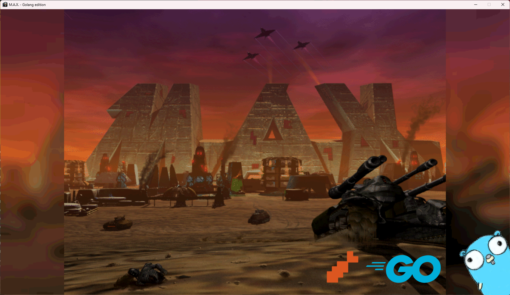
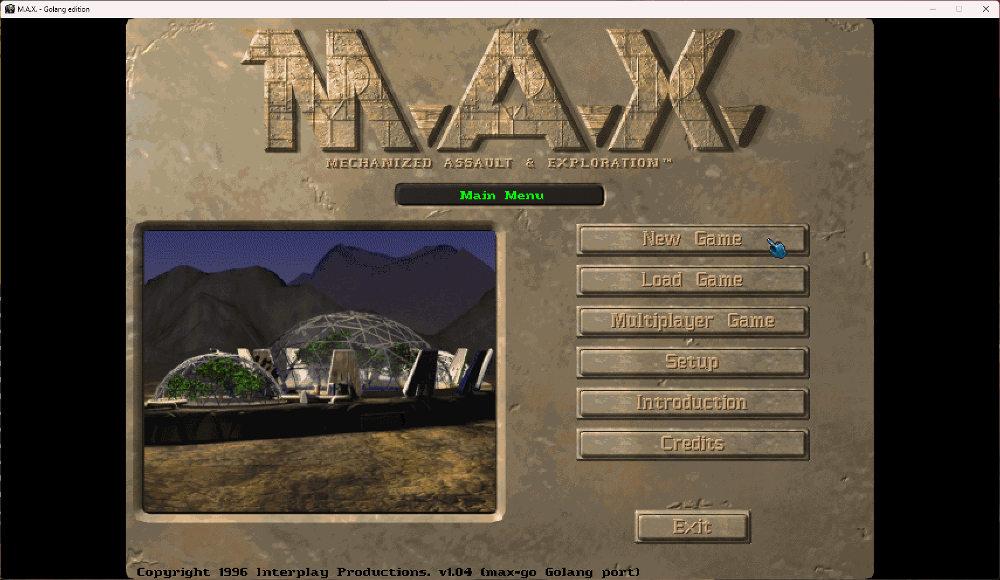
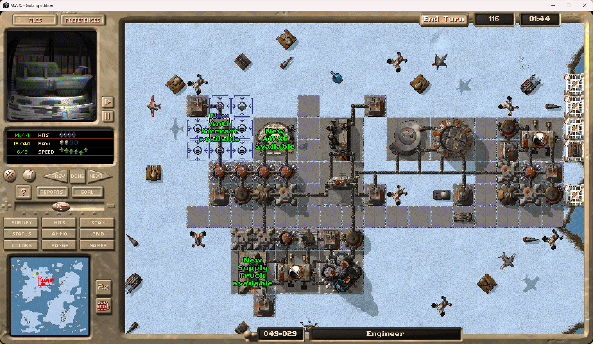
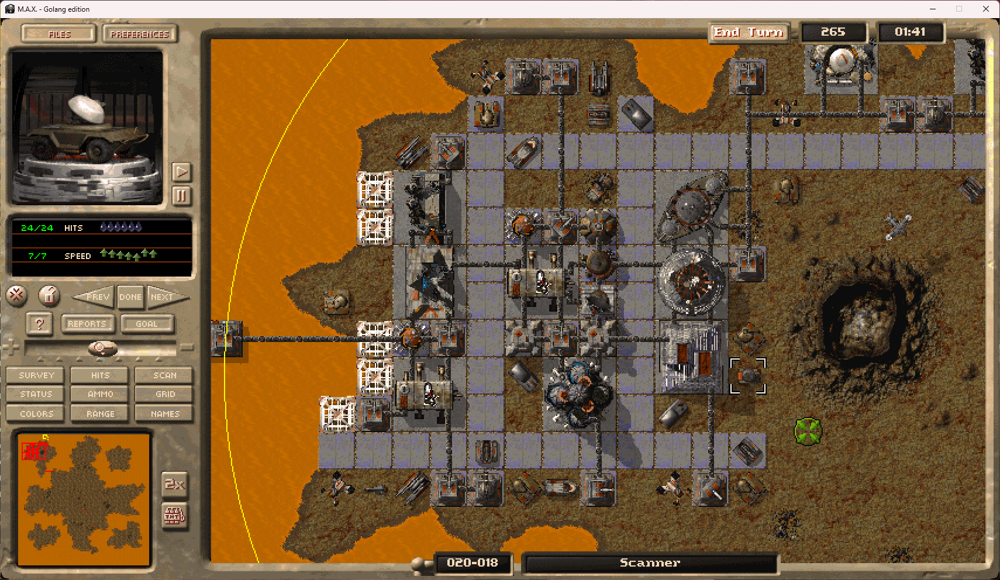

# max-go

A Go port of Interplay's **M.A.X.: Mechanized Assault & Exploration**, the 1996 turn based strategy game by Interplay Productions.





## The Project

This project targets the single-player mode of vanilla M.A.X.\
Game logic is derived from observed vanilla gameplay and reference C++ behaviour.\
max-go reimplements M.A.X. in Go on top of [Ebitengine](https://ebitengine.org/).\
It does not depend on SDL and avoids CGO for its libraries.\
Audio can use Oto, SoLoud, or miniaudio through wrapper libraries.

During the project, I made use of Claude Max (Opus and Fable) and Codex (GPT Sol) to learn and test the capabilities to work with AI in a large code base.\
Before you ask, yes, I made use of LLM's to help me assist in porting and writing code in this codebase.


## Original M.A.X. (I call it Vanilla), is not my idea

M.A.X. COPYRIGHT (C) 1996 Interplay Productions. All Rights Reserved.

This project or code has no affilation with Interplay or the current M.A.X. IP Holder!\
The project is pure a free time reverse engineering project of the 1996 MS-Dos game M.A.X. (Mechanized Assault & Exploration).


## Vanilla M.A.X.
The Golang M.A.X. port tries to stick as much as possible close to the Vanilla M.A.X. gameplay experience.


Except, a few Quality Of Life (QOL) improvements where added:
- Mouse scrollwheel, zooms in and out
- Grouping of units is not locked to 1..4 groups, but standard RTS 1..9 groups
- F2 recalls a special Debug menu (only when Debug is enabled in max-go.json)
- F10 cycle screen brightness settings
- F11 switches between Fullscreen/Windowed mode
- F12 takes screenshot in-game
- Added CMDline flags; the next bulletpoint was added as a specific feature for this reason
- Random mode using -random : it is like an extended Custom Game. You can tweak all details using flags (Difficulty, Alien Derelicts, resource Richness, NPC numbers, ...)
- max-restool (unpack or repack MAX.RES or other RES files if you want -- modding support)
- max-convert (converts game assets to bmp, png, wav or txt -- images, sprites, fonts, music, animations and movies)
- max-settings tool (edits the max-go.json using a tool)
- Vanilla Easteregg's are preserved (Waldo and rusted C&C Harvester)


## Source repository

The project repository is:

```
https://github.com/suglasp/max-go
```


## Game data is not included!

max-go is only the 'game engine'.\
It requires the data files of the original game (`MAX.RES`, `*.WRL`, `*.WAV`, `*.FLC`, ...).\
You can buy M.A.X. on [GOG.com](https://www.gog.com/game/m_a_x_m_a_x_2) or [Steam](https://store.steampowered.com/app/2338394/MAX_MAX_2/),\
then point `data_dir` in `max-go.json` at the installed game folder or copy over the data files so they reside next to the max-go binary.\
The max-go port is self contained, meaning savegame data, screenshots, and game data can all be placed in one folder, in order to run and play the game.

On a fresh start max-go can do the copying for you: when no data path is configured and `MAX.RES` is missing next to the binary,\
it looks for an installed GOG or Steam copy of M.A.X. on the machine (with a typed path prompt as fallback) and copies the game data over.\
During bootstreapping it will show progress on screen.\
This only automates pulling the data from a legitimate local install - the port itself still ships without any game data.\
A path set explicitly (`data_dir`, `MAX_DATA_DIR`, or `-datadir`) is used as given and never triggers the bootstrap.


## max-go Tooling

max-go comes with several addon utilities:
- max-restool : extracts the provided `*.RES` file(s)
- max-convert : converts the extracted data from the RES file(s), to today's standard formats like WAV,BMP,TXT,CSV,...
- max-setting : CLI based config tool to edit max-go.json


## max-go Documenting

During the porting process, we tried to document each file format M.A.X. uses.\
The files are stored in markdown under [docs/](docs/) folder.


## max-go Building and running

Building requires Go 1.26+ on Windows or Linux (x86-64 only).\
Since most OS versions nowadays are 64-bit, we targeted this port to compile and run on x86-64.

```
go build -o bin/ ./cmd/max-go
./bin/max-go
```

The convenience scripts build the game and tools, write CLI help files, copy the `lang-en-us.ini` UI strings file and the SoLoud and miniaudio native libraries from `dependencies/soloud-bin/` and `dependencies/miniaudio-bin/`,\
and then launch the game:

```
build-windows.cmd
```

```
./build-linux.sh
```

```
stage-windows.cmd
run-windows.cmd
```

```
./stage-linux.sh
./run-linux.sh
```

Set `MAX_GO_BUILD_ONLY=1` before running either script to build the artifacts without launching the game.\
Build dependency layout is documented in [docs/build/dependencies.md](docs/build/dependencies.md).


The `bin/` folder is ignored by git: put the compiled binary there, and optionally copy the game data next to it\
(or leave the data where it is and point `data_dir` in `max-go.json` at it).\
Game data files (`*.RES`, `*.WRL`, ...) are ignored everywhere in this repository so they can never be committed by accident.

On first run a `max-go.json` is created next to the binary (audio backend `ebiten`, `soloud`, or `miniaudio`,\
fullscreen/window scale, volumes, keybinds)\
A `settings.json` from older max-go versions is still honored when both files exist, `max-go.json` wins.\
`video.widescreen` takes `true`, `false`, or `"auto"` (the default): `true` widens the live game view to 16:9 while all menus stay at the classic 4:3,\
matching the widescreen mode.\
Save games go into a `saves/` folder, also next to the binary.


## M.A.X. Cheat codes

The five vanilla cheat codes work in any single player game.\
press `[` during play, type the rest of the code, end with `]`. Then press Enter (Esc cancels).
- `[MAXSPY]` toggles revealing all enemy units
- `[MAXSURVEY]` toggles showing every resource deposit
- `[MAXSTORAGE]` refills the cargo of all your units
- `[MAXAMMO]` refills their ammo
- `[MAXSUPER]` doubles the combat stats of the selected unit


## max-go Debugging

Debugging output is controlled by the `debug` section of `max-go.json`: `"console": true` prints to the console (on Windows this also keeps the console window visible when the game is started by a double click).\
`"log_file": true` writes to `max-go.log` next to the binary, overwritten at every game start.\
Log lines are buffered in memory and written to disk every `log_buffer_lines` lines (default 100) so logging does not stall the game.


## max-go Extras

The first steps where taken to implement a build-in map editor. But it's far from complete.


## max-go License

The original Go source code in this repository is available under the MIT License.\
M.A.X.: Mechanized Assault & Exploration and its original assets are copyrighted by Interplay Entertainment.\
This project is an independent reimplementation and is not affiliated with or endorsed by Interplay.\
The MIT License applies only to the original source code in this repository. It does not cover the original game or its assets.\
Note: Dependancy libraries are shipped with their own license file.

## Example screenshots of the M.A.X. Go port

\
\

